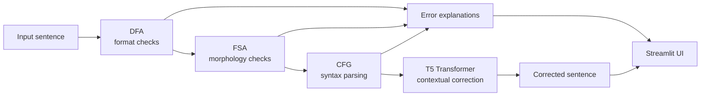

# Hybrid Grammar Correction System: CFG + Transformer

**An explainable grammar checker. It combines Formal Language Theory (DFA, FSA, CFG) with a T5 Transformer, so it tells you *where* and *why* a sentence is wrong as well as how to fix it.**

| Rule-based tools | Transformer-only tools | **This system** |
|---|---|---|
| Accurate but rigid | Context-aware but unpredictable | Structured detection **plus** fluent correction |
| Fails on complex sentences | Ignores formal grammar structure | Step-by-step, explainable feedback |

---

## Architecture



Each automaton checks a different layer of grammar:

| Layer | Concept | Checks | Example |
|---|---|---|---|
| **DFA** | Regular patterns | Capital start, end punctuation, no repeated marks, valid characters | `the boy went home` → must start with a capital |
| **FSA** | Word-level morphology (spaCy tokens + POS) | Tense, plural forms, subject-verb agreement | `childs` → `children`, `go … yesterday` → `went`, `He go` → `He goes` |
| **CFG** | Phrase structure (NLTK `ChartParser`) | Phrase order, missing constituents | `Dog the runs fast` → invalid word order |
| **Transformer** | T5 encoder-decoder (`prithivida/grammar_error_correcter_v1`) | Fluency, tense, structure, meaning-preserving rewrite | `gec: he go to school yesterday` → `He went to school yesterday.` |

### CFG used for syntax validation

```
S   -> NP VP
NP  -> Det N | Det Adj N | Pron | N
VP  -> V | V NP | V NP PP | V PP | V Adv
PP  -> P NP
Det -> 'a' | 'an' | 'the'
P   -> 'in' | 'on' | 'to' | 'at' | 'with'
```

The lexicon is filled in from spaCy POS tags at runtime, so the grammar can parse open-vocabulary sentences.

## Dataset

- Two CSV datasets of about **3,000 sentence pairs each** (training and evaluation), with `wrong` / `correct` columns
- A larger combined set of about **100,000 sentences** for fine-tuning
- Preprocessing: whitespace trimming, end-punctuation normalisation for CFG tokenisation, and lowercasing for the CFG lexicon

## Project Structure

```
Hybrid-Grammar-Correction-CFG-Transformer/
├── grammar/
│   ├── dfa_checker.py        # sentence-format automaton
│   ├── fsa_checker.py        # morphology / tense / agreement
│   ├── cfg_checker.py        # NLTK CFG syntax validation
│   ├── transformer.py        # T5 contextual corrector
│   └── pipeline.py           # hybrid pipeline
├── app.py                    # Streamlit interface
├── evaluate.py               # accuracy on wrong/correct CSV pairs
└── requirements.txt
```

## Getting Started

```bash
pip install -r requirements.txt
python -m spacy download en_core_web_sm
streamlit run app.py
```

Command-line usage:

```python
from grammar.pipeline import HybridGrammarCorrector
hgc = HybridGrammarCorrector()
print(hgc.check("he go to school yesterday"))
```

Evaluation on a CSV with `wrong,correct` columns:

```bash
python evaluate.py --data data/eval.csv
```

## Conclusions

- **Educational impact:** learners see exactly where errors occur, which makes the tool well suited to non-native speakers
- **Hybrid advantage:** the rule layers catch basic errors quickly, and the Transformer handles complex corrections and fluency
- **Explainability plus accuracy:** users get error explanations and high-quality corrections together

## Tech Stack

Python · NLTK · spaCy · Hugging Face Transformers (T5) · PyTorch · Streamlit · pandas

## Team

Team 12 · Amrita Vishwa Vidyapeetham, Coimbatore

- Dodla Nithya Sai
- M. Vishnu Vardhan
- P. Sreekar Reddy
- S. Beena Reddy
